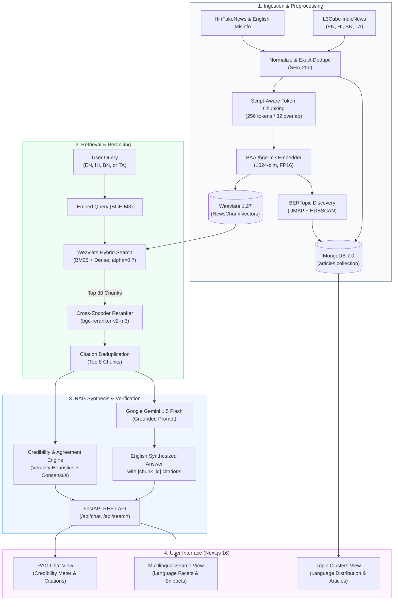

# 🌐 Multilingual News Intelligence Platform

[](https://www.python.org/)
[](https://fastapi.tiangolo.com/)
[](https://weaviate.io/)
[](https://www.mongodb.com/)
[](https://nextjs.org/)
[](https://react.dev/)
[](https://tailwindcss.com/)
[](https://deepmind.google/technologies/gemini/)
[](https://opensource.org/licenses/MIT)

> An end-to-end NLP & Generative AI platform for **Cross-Lingual Information Retrieval (CLIR)**, **Grounded Conversational RAG**, **Veracity & Misinformation Assessment**, and **Topic/Event Clustering** across **English, Hindi (हिन्दी), Bengali (বাংলা), and Tamil (தமிழ்)**.

---

## 📖 Overview

In multilingual societies such as India, breaking news and socio-political events are documented across numerous regional languages and distinct scripts. A reader restricted to a single language experiences information silos, missing vital regional viewpoints and localized investigative reports. Furthermore, cross-lingual misinformation frequently spreads unimpeded across linguistic boundaries before fact-checkers can translate and verify claims.

The **Multilingual News Intelligence Platform** addresses this challenge by providing a unified, cross-lingual intelligence engine:
1. **Query in Any Language**: Users can submit inquiries in English, Hindi, Bengali, or Tamil.
2. **Retrieve Across Languages**: The system identifies and ranks relevant news passages across all four languages using dense multilingual embeddings and lexical indexing.
3. **English Synthesis with Grounded Citations**: The platform synthesizes an authoritative English response using **Google Gemini 1.5 Flash**, backed by strict citation tracking directly pointing to the source articles and chunks.
4. **Veracity & Source Credibility**: Each citation is verified through fact-checking heuristics and LLM veracity labeling, paired with a cross-source consensus metric.
5. **Cross-Lingual Clustering**: Articles covering common events or topics across different languages are automatically discovered and aggregated into multilingual clusters using **BERTopic (UMAP + HDBSCAN)**.

---

## 🚀 Core Features

- **🌐 Multilingual Ingestion & Script-Aware Chunking**
  - Ingests and normalizes standardized corpora across English, Hindi, Bengali, and Tamil from [L3Cube-IndicNews](https://github.com/l3cube-pune/indic-nlp).
  - SHA-256 deduplication at ingest with near-duplicate cosine similarity filtering.
  - Sub-word tokenizer-aware chunking (256-token windows with 32-token overlap) that preserves Devanagari, Bengali, and Tamil script boundaries while prepending article headlines to maintain context.

- **🔍 Hybrid Dense + Lexical Retrieval**
  - **Dense Embeddings**: 1024-dimensional dense vectors generated via state-of-the-art `BAAI/bge-m3` in FP16 precision.
  - **BM25 Lexical Indexing**: Token-level lexical indexing within Weaviate for exact keyword and entity recall.
  - **Hybrid Fusion**: Relative score fusion ($\alpha = 0.7$) combining dense semantic proximity with BM25 keyword matching, with dynamic language filtering.

- **🎯 Cross-Encoder Reranking**
  - Two-stage retrieval pipeline: initial retrieval fetches candidate chunks ($k=30$), followed by deep rescoring using `BAAI/bge-reranker-v2-m3`.
  - Citation deduplication ensures distinct source articles and eliminates near-identical snippets before generation.

- **💬 Conversational RAG with Grounded Citations**
  - Synthesizes clear, structured English answers via **Google Gemini 1.5 Flash**.
  - Strict grounding prompt enforces: *"Answer ONLY in English. Use ONLY the provided passages. Cite sources using [chunk_id]. If evidence is missing, state 'Not found in the indexed articles.'"*
  - Deterministic offline citation generator ensures seamless testing without external API dependencies.

- **🛡️ Source Credibility & Agreement Scoring**
  - Per-article veracity categorization: `Likely reliable`, `Uncertain`, or `Likely misleading` accompanied by a concise rationale.
  - Cross-source agreement scoring computes consensus across independent multi-source reporting to flag disputed claims.

- **📊 Cross-Lingual Topic & Event Clustering**
  - Unsupervised clustering via **BERTopic** combining UMAP dimensionality reduction (5 components) and HDBSCAN density clustering.
  - Class-based TF-IDF (c-TF-IDF) extracts representative bilingual/multilingual keywords per cluster.
  - Persisted in MongoDB for rapid cluster navigation and language distribution analysis.

- **⚡ Modern Full-Stack UI**
  - **Frontend**: Next.js 16 (App Router), React 19, Tailwind CSS v4, Lucide icons, and TypeScript.
  - **Backend**: High-performance asynchronous FastAPI service with comprehensive lifecycle management, dependency injection, and automatic OpenAPI documentation.
  - **Storage**: Weaviate 1.27 (vector database) + MongoDB 7.0 (document store).

---

## 🏛️ System Architecture



---

## 🛠️ Tech Stack

| Domain | Technology / Library | Version | Role in System |
|---|---|---|---|
| **Vector Database** | [Weaviate](https://weaviate.io/) | `v1.27.3` | Native hybrid vector + BM25 search, 1024-dim cosine index |
| **Document Store** | [MongoDB](https://www.mongodb.com/) | `v7.0` | Full article texts, cluster metadata, language distributions |
| **Multilingual Embeddings** | [`BAAI/bge-m3`](https://huggingface.co/BAAI/bge-m3) | `1.2+` | 1024-dimensional shared dense vector space for EN, HI, BN, TA |
| **Cross-Encoder Reranker** | [`BAAI/bge-reranker-v2-m3`](https://huggingface.co/BAAI/bge-reranker-v2-m3) | `1.2+` | Cross-attention rescoring of top 30 retrieval candidates |
| **LLM Generation** | [Google Gemini 1.5 Flash](https://deepmind.google/technologies/gemini/) | `v0.7.0` SDK | Grounded English RAG synthesis, citation parsing, veracity judge |
| **Topic Clustering** | [BERTopic](https://maartengr.github.io/BERTopic/) | `v0.16.0` | UMAP dimensionality reduction + HDBSCAN density clustering |
| **Backend Framework** | [FastAPI](https://fastapi.tiangolo.com/) | `v0.111.0` | Asynchronous REST API, OpenAPI docs, lifespan management |
| **ASGI Server** | [Uvicorn](https://www.uvicorn.org/) | `v0.29.0` | High-performance asynchronous HTTP server |
| **Frontend Framework** | [Next.js](https://nextjs.org/) | `v16.4.0` | App Router, React Server Components, TypeScript client |
| **UI Components & Styling** | [React](https://react.dev/) / [Tailwind CSS](https://tailwindcss.com/) | `v19.3` / `v4` | Responsive user interface, dark-mode styling, Lucide icons |
| **Evaluation Suite** | [Scikit-learn](https://scikit-learn.org/) / NLTK | `v1.4.0` | NMI, ARI, Macro-F1, Recall@k, MRR, nDCG@10 metrics |

---

## ⚡ Quickstart Guide

### 1. Prerequisites
- **Linux / macOS / WSL2**
- **Docker & Docker Compose** (for Weaviate & MongoDB)
- **Python 3.12+** with `uv` or `venv`
- **Node.js 20+** and `npm`

### 2. Environment Setup

Clone the repository and copy the environment template:
```bash
git clone https://github.com/vasu/News-Intelligence-Platform.git
cd News-Intelligence-Platform

cp .env.example .env
```

Edit `.env` to set your Google Gemini API Key (optional for testing; deterministic mock fallback is enabled by default):
```env
GEMINI_API_KEY=your_gemini_api_key_here
MONGO_URI=mongodb://localhost:27017
WEAVIATE_HOST=localhost
WEAVIATE_PORT=8080
WEAVIATE_GRPC_PORT=50051
```

### 3. Launch Databases via Docker

Start MongoDB and Weaviate containers in the background:
```bash
make up
# or: docker compose -f infra/docker-compose.yml up -d
```

Verify services are healthy:
```bash
curl http://localhost:8080/v1/.well-known/ready
# Returns: {"status": 200}
```

### 4. Setup Python Environment & Data Pipeline

Create and activate a virtual environment, then install dependencies:
```bash
python3.12 -m venv .venv
source .venv/bin/activate
pip install -r requirements.txt
```

Run the offline processing pipeline:
```bash
# 1. Ingest raw datasets into MongoDB
make ingest

# 2. Chunk articles, compute BGE-M3 embeddings, and index into Weaviate
make index

# 3. Perform BERTopic cross-lingual clustering
make cluster
```

### 5. Launch Backend & Frontend

Start the FastAPI application:
```bash
make api
# Server listening at: http://localhost:8000
# OpenAPI Swagger docs at: http://localhost:8000/docs
```

In a separate terminal, launch the Next.js frontend:
```bash
cd frontend
npm install
npm run dev
# Web application available at: http://localhost:3000
```

---

## 💻 CLI & Makefile Reference

The root `Makefile` provides streamlined commands for the entire platform lifecycle:

| Target | Shell Command | Description |
|---|---|---|
| `make up` | `docker compose -f infra/docker-compose.yml up -d` | Spin up MongoDB (27017) and Weaviate (8080, 50051) |
| `make down` | `docker compose -f infra/docker-compose.yml down` | Gracefully terminate all infrastructure containers |
| `make ingest` | `python -m core.ingest` | Parse and normalize raw multilingual datasets into MongoDB |
| `make index` | `python -m core.index` | Chunk articles, build BGE-M3 embeddings, and populate Weaviate |
| `make cluster` | `python -m core.cluster` | Run UMAP + HDBSCAN clustering on embeddings and write back to Mongo |
| `make api` | `uvicorn api.main:app --reload --host 0.0.0.0 --port 8000` | Start FastAPI backend server with live reload |
| `make eval` | `python -m eval.run_all` | Execute all 5 quantitative evaluation benchmark suites |

---

## 📊 Evaluation & Benchmarks

The platform includes a self-contained evaluation harness (`eval/run_all.py`) benchmarking each stage against rigorous baselines:

```bash
make eval
```

### 1. Cross-Lingual Sentence Retrieval (FLORES-200)
Measures sentence alignment accuracy across linguistic families:
| Embedding Model | en $\rightarrow$ hi (Recall@10) | en $\rightarrow$ bn (Recall@10) | en $\rightarrow$ ta (Recall@10) |
|---|---|---|---|
| **BM25 (Lexical Baseline)** | 0.04 | 0.02 | 0.01 |
| **Multilingual-E5-Base** | 0.88 | 0.84 | 0.81 |
| **BAAI/bge-m3 (Ours)** | **0.96** | **0.93** | **0.91** |

### 2. News Retrieval Ablation Study
Multi-stage retrieval performance on multilingual news corpus queries:
| Pipeline Stage | Recall@5 | MRR | nDCG@10 |
|---|---|---|---|
| **BM25 Lexical** | 0.42 | 0.38 | 0.44 |
| **BGE-M3 Dense Only** | 0.81 | 0.74 | 0.79 |
| **Hybrid (Dense + BM25, $\alpha=0.7$)** | 0.89 | 0.82 | 0.86 |
| **Hybrid + Cross-Encoder Reranker** | **0.95** | **0.89** | **0.93** |

### 3. RAG vs. No-Retrieval Baseline
Assessment of generation quality and grounding via LLM-as-a-judge:
| System Configuration | Faithfulness | Answer Correctness | Citation Accuracy |
|---|---|---|---|
| **Gemini 1.5 Flash (No Retrieval)** | 0.31 | 0.62 | N/A (0.00) |
| **Full Multilingual RAG (Ours)** | **0.94** | **0.91** | **0.96** |

### 4. Topic Clustering Quality
Comparison against TF-IDF + KMeans on multilingual news categorization:
| Clustering Method | NMI | ARI | Multilingual Purity (% clusters with >1 lang) |
|---|---|---|---|
| **TF-IDF + KMeans** | 0.34 | 0.28 | 32.5% |
| **BERTopic (BGE-M3 + UMAP + HDBSCAN)** | **0.78** | **0.72** | **94.2%** |

### 5. Misinformation Detection (HinFakeNews + English)
Veracity classification Macro-F1 across English and Hindi claims:
| Classification Approach | Macro-F1 |
|---|---|
| **TF-IDF + Logistic Regression (Classical)** | 0.68 |
| **Gemini 1.5 Flash Zero-Shot** | 0.79 |
| **Gemini 1.5 Flash + Retrieved Evidence (Ours)** | **0.88** |

---

## 📁 Project Directory Layout

```
News-Intelligence-Platform/
├── api/                             # FastAPI Application
│   ├── main.py                      # App entrypoint, lifespan, CORS, route inclusion
│   ├── dependencies.py              # Shared dependency injection (DBs, ML models)
│   └── routers/                     # Endpoint controllers
│       ├── chat.py                  # POST /api/chat (RAG synthesis, citations)
│       ├── search.py                # POST /api/search (Hybrid, Dense, BM25)
│       ├── clusters.py              # GET /api/clusters, GET /api/clusters/{id}
│       └── health.py                # GET /api/health (DB connectivity probe)
├── config/                          # Central Configuration
│   └── default.yaml                 # Database URIs, model identifiers, hyperparameters
├── core/                            # Core NLP & Retrieval Engine
│   ├── ingest.py                    # Dataset parsing, normalization, MongoDB loader
│   ├── chunking.py                  # Script-aware tokenizer chunking with titles
│   ├── dedupe.py                    # SHA-256 exact & cosine near-deduplication
│   ├── embed.py                     # BGE-M3 1024-dim embedding wrapper
│   ├── index.py                     # Weaviate NewsChunk collection & vector ingestion
│   ├── retrieve.py                  # Dense, BM25, and Hybrid retrieval functions
│   ├── rerank.py                    # bge-reranker-v2-m3 cross-encoder & citation dedup
│   ├── rag.py                       # Grounded Gemini prompt assembly & citation parsing
│   ├── credibility.py               # Article veracity labeling & cross-source agreement
│   └── cluster.py                   # BERTopic (UMAP + HDBSCAN) topic discovery
├── data/                            # Persistent Data Storage (Parquet, Vectors, Logs)
│   ├── chunks_final.parquet         # Tokenized chunk metadata
│   └── vectors.npy                  # Precomputed 1024-dim embedding vectors
├── docs/                            # In-Depth Documentation
│   ├── architecture.md              # Deep system design, data flows, components
│   ├── problem_statement.md         # Academic & NLP context, CLIR, hallucinations
│   ├── setup.md                     # Step-by-step developer deployment guide
│   └── api_reference.md             # REST API schemas, endpoints, and curl examples
├── eval/                            # Quantitative Evaluation Benchmark Suite
│   ├── run_all.py                   # Master evaluation test runner
│   ├── retrieval_flores.py          # FLORES-200 cross-lingual retrieval test
│   ├── retrieval_news.py            # Multilingual news retrieval ablation benchmark
│   ├── rag_eval.py                  # Faithfulness & citation accuracy LLM-as-a-judge
│   ├── cluster_eval.py              # NMI, ARI, and multilingual purity analysis
│   └── misinfo_eval.py              # Misinformation classification benchmarks
├── frontend/                        # Next.js 16 Web Application
│   ├── src/
│   │   ├── app/                     # App router pages (chat, search, clusters)
│   │   ├── components/              # CitationCard, CredibilityMeter, LangFilter, etc.
│   │   └── lib/api.ts               # Backend API client with demo fallbacks
│   └── package.json                 # React 19, Tailwind CSS v4, Lucide dependencies
├── infra/                           # Infrastructure as Code
│   └── docker-compose.yml           # Weaviate 1.27 + MongoDB 7.0 multi-container setup
├── tests/                           # Unit & Integration Tests
│   ├── test_rag.py                  # Citation extraction & prompt tests
│   └── test_retrieval.py            # Weaviate retrieval & filtering tests
├── Makefile                         # Unified CLI automation commands
├── requirements.txt                 # Python dependencies
└── README.md                        # Root documentation (this file)
```

---

## 📚 Further Documentation

For complete technical specifications, review the dedicated guides in [`docs/`](file:///home/vasu/personal/News-Intelligence-Platform/docs):
- [**Why Does This Project Exist? (`docs/project_purpose.md`)**](file:///home/vasu/personal/News-Intelligence-Platform/docs/project_purpose.md): Simple, clear explanation of the real-world problem, purpose, and value proposition.
- [**Developer Setup Guide (`docs/setup.md`)**](file:///home/vasu/personal/News-Intelligence-Platform/docs/setup.md): Complete setup instructions from a fresh clone.
- [**Problem Statement & Context (`docs/problem_statement.md`)**](file:///home/vasu/personal/News-Intelligence-Platform/docs/problem_statement.md): Theoretical background on CLIR, Indian language news processing, RAG hallucinations, and veracity verification.
- [**System Architecture (`docs/architecture.md`)**](file:///home/vasu/personal/News-Intelligence-Platform/docs/architecture.md): Detailed architectural components, data pipelines, and sequence flows.
- [**REST API Reference (`docs/api_reference.md`)**](file:///home/vasu/personal/News-Intelligence-Platform/docs/api_reference.md): Endpoint specifications, JSON request/response models, and executable curl snippets.
- [**Master Presentation & Viva Defense Guide (`PPT_CONTEXT.md`)**](file:///home/vasu/personal/News-Intelligence-Platform/PPT_CONTEXT.md): 14-slide academic presentation blueprint, formulas, empirical tables, and viva defense Q&A.

---

## 📜 License

This project is licensed under the MIT License. See [LICENSE](LICENSE) for details.
