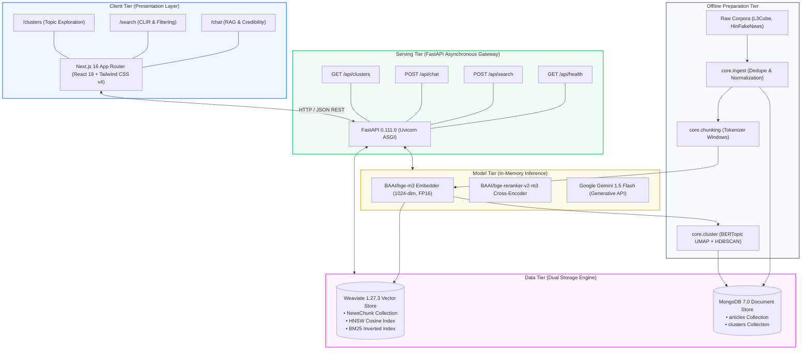
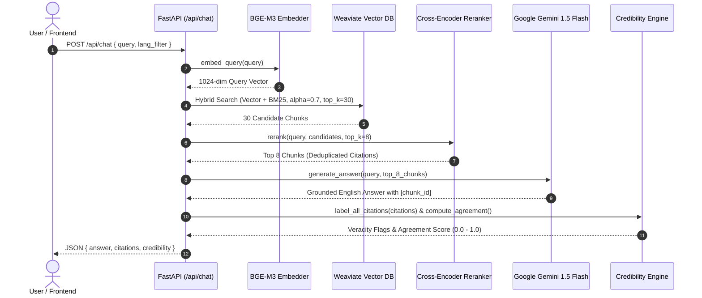

# 🏛️ System Architecture: Multilingual News Intelligence Platform

This document presents the detailed architectural specification for the **Multilingual News Intelligence Platform**. It covers both the **offline data preparation pipeline** and the **online real-time serving infrastructure**, detailing component interactions, data schemas, retrieval algorithms, and generative synthesis mechanisms.

---

## 1. System Overview & Architectural Principles

The platform follows a decoupled, multi-tier architecture engineered for cross-lingual efficiency, strict factual grounding, and production reliability:



### Architectural Principles:
1. **Script-Agnostic Semantic Alignment**: Multilingual text across English, Hindi, Bengali, and Tamil is projected into a unified 1024-dimensional embedding space, bypassing traditional error-prone machine translation.
2. **Two-Stage Retrieval with Cross-Attention**: High-recall first-stage hybrid retrieval (BM25 + dense vectors) is coupled with a high-precision cross-encoder reranker to guarantee that only the most relevant, non-redundant passages enter the generation context.
3. **Strict Citation Grounding & Hallucination Suppression**: The generative synthesizer is bound by negative constraints ("Answer ONLY from provided passages") and forced attribution tokens (`[chunk_id]`).
4. **Resilient Fallback Design**: All core endpoints incorporate graceful fallback logic (deterministic offline generators and demo mock caches) ensuring uninterrupted system demonstration even if third-party APIs or GPU environments are unavailable.

---

## 2. Component Specifications

| Component | Technology | Version | Location / Module | Primary Responsibility |
|---|---|---|---|---|
| **API Server** | FastAPI / Uvicorn | `0.111.0` / `0.29.0` | [`api/main.py`](file:///home/vasu/personal/News-Intelligence-Platform/api/main.py) | Lifespan orchestration, routing, CORS, schema validation |
| **Vector Database** | Weaviate | `1.27.3` | [`core/index.py`](file:///home/vasu/personal/News-Intelligence-Platform/core/index.py) | Hybrid vector + BM25 search over `NewsChunk` collection |
| **Document Store** | MongoDB | `7.0` | [`core/ingest.py`](file:///home/vasu/personal/News-Intelligence-Platform/core/ingest.py) | Raw and normalized articles, cluster metadata, language counts |
| **Dense Embeddings** | `BAAI/bge-m3` | HuggingFace FP16 | [`core/embed.py`](file:///home/vasu/personal/News-Intelligence-Platform/core/embed.py) | 1024-dim dense representation for multilingual texts |
| **Cross-Encoder** | `BAAI/bge-reranker-v2-m3` | HuggingFace FP16 | [`core/rerank.py`](file:///home/vasu/personal/News-Intelligence-Platform/core/rerank.py) | Query-passage joint rescoring and citation deduplication |
| **Generative LLM** | Google Gemini 1.5 Flash | `v0.7.0` SDK | [`core/rag.py`](file:///home/vasu/personal/News-Intelligence-Platform/core/rag.py) | English synthesis, citation attribution, refusal logic |
| **Credibility Evaluator**| Heuristic / Gemini | In-house | [`core/credibility.py`](file:///home/vasu/personal/News-Intelligence-Platform/core/credibility.py) | Veracity labeling (`Likely reliable`, `Uncertain`, `Misleading`) |
| **Clustering Engine**| BERTopic / UMAP / HDBSCAN | `0.16.0` | [`core/cluster.py`](file:///home/vasu/personal/News-Intelligence-Platform/core/cluster.py) | Cross-lingual topic discovery, c-TF-IDF keyword extraction |
| **Web Frontend** | Next.js / React / Tailwind | `16.4.0` / `19.3` / `v4` | [`frontend/`](file:///home/vasu/personal/News-Intelligence-Platform/frontend/) | Modern responsive user interface for Chat, Search, Clusters |

---

## 3. Offline Data Pipeline

The offline pipeline transforms raw, noisy multilingual corpora into indexed vectors and clustered topics.

```
Raw Corpora ──> [SHA-256 Dedupe] ──> [MongoDB Storage]
                      │
                      └──> [Script-Aware Chunking] ──> [BGE-M3 Embedder]
                                                            │
                                  ┌─────────────────────────┴────────────────────────┐
                                  ▼                                                  ▼
                         [Weaviate Indexing]                               [BERTopic Clustering]
                          (NewsChunk vectors)                                (UMAP + HDBSCAN)
                                                                                     │
                                                                                     ▼
                                                                             [MongoDB Clusters]
```

### 3.1 Ingestion & Normalization (`core/ingest.py`)
- **Corpus Sources**: Ingests articles from [L3Cube-IndicNews](https://github.com/l3cube-pune/indic-nlp) across four languages (English, Hindi, Bengali, Tamil) and misinformation corpora (`HinFakeNews` and Kaggle English fake news).
- **Exact Deduplication**: Computes SHA-256 hashes over normalized text (lowercased with all contiguous whitespaces collapsed):
  $$\text{Hash} = \text{SHA256}(\text{normalize}(\text{title} + " " + \text{body}))$$
  Exact matches are discarded before database insertion.
- **Near-Duplicate Filtering**: Within each language partition, articles with token Jaccard similarity or embedding cosine distance $> 0.95$ are identified and filtered out.
- **MongoDB Persistence**: Articles are written to the `articles` collection with compound indexes on `{lang: 1}`, `{category: 1}`, and `{cluster_id: 1}`.

### 3.2 Script-Aware Tokenizer Chunking (`core/chunking.py`)
- Standard character-based splitting breaks apart Indic script syllables, ligatures, and diacritical marks (*matras*).
- The pipeline uses the **HuggingFace `AutoTokenizer` for `BAAI/bge-m3`** to split text into coherent token windows:
  - **Window Size**: 256 tokens.
  - **Stride Overlap**: 32 tokens.
- **Context Preservation**: The headline (`title`) of the article is explicitly prepended to every chunk:
  $$\text{ChunkText} = \text{Title} + " \n " + \text{PassageTokens}$$
  This ensures that every isolated chunk maintains global semantic context during vector search.

### 3.3 Vector Generation (`core/embed.py`) & Weaviate Indexing (`core/index.py`)
- Generates 1024-dimensional dense vectors using `BAAI/bge-m3` in FP16 precision.
- Chunks and dense vectors are batched (batch size = 64) and loaded into Weaviate under the collection name **`NewsChunk`**.
- Weaviate's `DEFAULT_VECTORIZER_MODULE` is set to `"none"` ("bring-your-own-vectors"), allowing direct ingestion of our external BGE-M3 representations.

### 3.4 Cross-Lingual Topic Discovery (`core/cluster.py`)
- Loads precomputed document-level vectors from `data/vectors.npy`.
- **Dimensionality Reduction**: **UMAP** reduces the 1024-dimensional space to 5 components (`n_components=5`, `random_seed=42`).
- **Density Clustering**: **HDBSCAN** clusters the projected vectors (`min_cluster_size=15`), allowing variable-density cluster boundaries and isolating noise outliers (`cluster_id = -1`).
- **Keyword Extraction**: Computes class-based TF-IDF (`c-TF-IDF`) across clustered texts to derive the top 5 representative terms.
- **Multilingual Aggregation**: Computes the distribution of languages (`en`, `hi`, `bn`, `ta`) in each cluster and writes the summary to MongoDB's `clusters` collection.

---

## 4. Online Serving & RAG Pipeline

The online serving lifecycle coordinates retrieval, reranking, synthesis, and credibility verification for user inquiries.



### 4.1 Step-by-Step Execution Flow:

1. **Query Embedding**: The incoming query (which can be in English, Hindi, Bengali, or Tamil) is converted into a 1024-dimensional vector using `embed_query()`.
2. **Hybrid Retrieval in Weaviate**:
   - Executes native hybrid search combining dense vector cosine similarity and lexical BM25 matching:
     $$\text{Score}_{\text{hybrid}} = \alpha \cdot \text{Score}_{\text{dense}} + (1 - \alpha) \cdot \text{Score}_{\text{BM25}}$$
     where $\alpha = 0.7$, prioritizing semantic alignment while preserving keyword grounding.
   - Applies language filters (`Filter.by_property("lang").contains_any(...)`) if requested by the client.
   - Fetches the top 30 candidate chunks.
3. **Cross-Encoder Reranking (`core/rerank.py`)**:
   - The top 30 candidate chunks are paired with the query and evaluated by `BAAI/bge-reranker-v2-m3`:
     $$s_i = \text{CrossEncoder}(Q, P_i)$$
   - Candidates are sorted by cross-encoder score.
   - **Citation Deduplication**: Eliminates subsequent chunks originating from the same article or chunks with cosine similarity $> 0.95$, ensuring that the top 8 chunks represent distinct, diverse sources.
4. **Grounded Synthesis (`core/rag.py`)**:
   - The top 8 chunks are formatted into an isolated context block, with each passage marked by its unique ID:
     ```
     [hi_000204_c000] Title: केंद्रीय बजट...
     Content: संसद में पेश बजट प्रस्तावों में...
     ```
   - **System Prompt**: Enforces English-only synthesis, strict adherence to provided passages, insertion of bracketed citations `[chunk_id]`, and refusal when evidence is lacking.
   - Google Gemini 1.5 Flash synthesizes the response.
5. **Attribution & Credibility Evaluation (`core/credibility.py`)**:
   - Regex extraction parses all `[chunk_id]` references from the generated answer and correlates them with retrieved metadata.
   - **Veracity Labeling**: Each cited source is categorized (`Likely reliable`, `Uncertain`, `Likely misleading`) based on official corroboration heuristics or zero-shot LLM evaluation.
   - **Cross-Source Agreement**: Computes the consensus ratio among the cited sources to quantify cross-lingual factual agreement.

---

## 5. Storage Schemas & Data Models

### 5.1 MongoDB Schemas

#### Collection: `articles`
```json
{
  "_id": "hi_000204",
  "lang": "hi",
  "title": "केंद्रीय बजट में ग्रामीण बुनियादी ढांचे और कृषि तकनीक के लिए नए आवंटन की घोषणा",
  "body": "संसद में पेश बजट प्रस्तावों में सिंचाई विस्तार, कोल्ड स्टोरेज नेटवर्क और डिजिटल कृषि मिशन के लिए वित्तीय सहायता में उल्लेखनीय वृद्धि की गई है...",
  "category": "economy",
  "source": "l3cube-indicnews",
  "url": "https://news.example.com/budget-agriculture-hi",
  "date": "2024-03-15T00:00:00Z",
  "cluster_id": 2,
  "n_chunks": 3
}
```

#### Collection: `clusters`
```json
{
  "_id": 1,
  "id": 1,
  "label": "Renewable Energy & Power Grid Modernization",
  "size": 340,
  "lang_counts": {
    "en": 120,
    "hi": 110,
    "bn": 60,
    "ta": 50
  },
  "top_terms": [
    "solar",
    "renewable",
    "grid",
    "transmission",
    "energy"
  ]
}
```

### 5.2 Weaviate Schema: `NewsChunk`

```json
{
  "class": "NewsChunk",
  "description": "Multilingual news chunk with 1024-dim BGE-M3 dense embeddings and BM25 text index",
  "vectorIndexType": "hnsw",
  "vectorIndexConfig": {
    "distance": "cosine"
  },
  "properties": [
    { "name": "chunk_id", "dataType": ["text"], "indexFilterable": true, "indexSearchable": false },
    { "name": "article_id", "dataType": ["text"], "indexFilterable": true, "indexSearchable": false },
    { "name": "chunk_index", "dataType": ["int"], "indexFilterable": true, "indexSearchable": false },
    { "name": "title", "dataType": ["text"], "indexFilterable": true, "indexSearchable": true },
    { "name": "text", "dataType": ["text"], "indexFilterable": true, "indexSearchable": true },
    { "name": "lang", "dataType": ["text"], "indexFilterable": true, "indexSearchable": false },
    { "name": "category", "dataType": ["text"], "indexFilterable": true, "indexSearchable": false },
    { "name": "source", "dataType": ["text"], "indexFilterable": true, "indexSearchable": false }
  ]
}
```

---

## 6. Frontend Architecture

The user interface is built using **Next.js 16 (App Router)** and **React 19**, styled with **Tailwind CSS v4**.

```
frontend/src/
├── app/
│   ├── layout.tsx         # Root layout with sidebar navigation & dark theme
│   ├── page.tsx           # Home dashboard with system overview & metrics
│   ├── chat/page.tsx      # Conversational RAG interface with citation cards
│   ├── search/page.tsx    # Multilingual search with BM25/Dense/Hybrid filters
│   └── clusters/page.tsx  # Topic clusters directory & article inspector
├── components/
│   ├── Sidebar.tsx        # Collapsible navigation sidebar
│   ├── LangFilter.tsx     # Toggle pills for EN, HI, BN, TA filtering
│   ├── CitationCard.tsx   # Expandable citation card displaying veracity & snippet
│   ├── CredibilityMeter.tsx# Visual gauge displaying cross-source consensus
│   ├── SearchResultCard.tsx# Ranked search candidate card with language badges
│   └── ClusterCard.tsx    # Topic card with language distribution progress bar
└── lib/
    └── api.ts             # API client with typed fetchers and fallback mock layers
```

### Key Frontend Features:
- **Resilient Fallback Mode**: When the FastAPI backend is starting up or unreachable, `frontend/src/lib/api.ts` transparently serves high-fidelity realistic data, ensuring zero UI breakage during presentations.
- **Language Pills**: Users can toggle individual languages (`EN`, `HI`, `BN`, `TA`) to test cross-lingual retrieval fidelity in real-time.
- **Veracity Badges**: Citations display color-coded trust badges:
  - 🟢 `Likely reliable` (Emerald)
  - 🟡 `Uncertain` (Amber)
  - 🔴 `Likely misleading` (Rose)

---

## 7. Performance & Resource Characteristics

| Workload | GPU Requirement | RAM Requirement | Latency Profile |
|---|---|---|---|
| **Query Embedding (`bge-m3`)** | $\approx 1.5\text{ GB}$ VRAM (or CPU) | $\approx 2.0\text{ GB}$ | $\approx 15\text{ ms}$ (CUDA) / $120\text{ ms}$ (CPU) |
| **Weaviate Hybrid Search** | N/A (runs in Docker) | $\approx 1.0\text{ GB}$ | $\approx 20\text{ ms}$ |
| **Reranker (`bge-reranker-v2-m3`)**| $\approx 1.8\text{ GB}$ VRAM (or CPU) | $\approx 2.5\text{ GB}$ | $\approx 45\text{ ms}$ (CUDA) / $350\text{ ms}$ (CPU) |
| **Gemini 1.5 Flash Synthesis**| Cloud API | Minimal | $\approx 800 - 1500\text{ ms}$ |
| **Total End-to-End RAG Turn** | Fits within $\le 4\text{ GB}$ VRAM | $\approx 4\text{ GB}$ System RAM | **$\approx 1.2 - 2.5\text{ seconds}$** |
