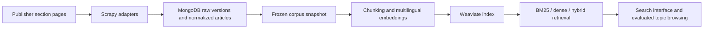

# Architecture and implementation status

## Intended research flow

This is the intended research pipeline, not a claim that every stage currently forms a complete, validated product. The bounded scraper pilot, Mongo storage, local model inference and service readiness checks have been verified; corpus quality, full snapshot-to-index reproducibility, retrieval relevance, clustering usefulness and complete UI workflows remain open. See [OVERHAUL_PLAN.md](OVERHAUL_PLAN.md) for phase status and acceptance criteria.

## Components

- **Collection:** Scrapy source-language adapters use publisher section mappings to shared categories. Raw article versions and normalized article records are stored in MongoDB. The live pilot is small and its source-section categories are weak labels, not verified article themes.
- **Processing and retrieval:** The intended pipeline freezes a corpus, chunks article text, creates multilingual vectors, and compares BM25, dense and hybrid search using Weaviate. BGE-M3 embedding and cross-encoder inference were verified locally; their retrieval quality has not been measured.
- **API:** FastAPI exposes `/api/search`, `/api/chat`, `/api/clusters` and `/api/health`. Valid empty search/topic collections are represented as empty results; unavailable dependencies produce errors; the API does not fabricate fallback records. Chat requires retrieved evidence and explicit citations.
- **Frontend:** Next.js provides search, chat and topic views. It no longer supplies demo article fallbacks. End-to-end behavior against a representative research corpus remains unverified.

## Reliability behavior

- Embedding or index failures make dense/hybrid retrieval unavailable; no random vectors are substituted.
- Optional reranker failure preserves the original candidate order and scores.
- Chat does not invent a canned fallback when a provider is missing or fails.
- `GET /` reports `degraded` when embedding or Weaviate is unavailable; `GET /api/health` reports `degraded` when MongoDB or Weaviate is unavailable.
- Topic listing does not delete stored data. The legacy cluster generation path refuses a nonempty store rather than replacing existing records.
- Legacy synthetic evaluation entrypoints are disabled. Existing ignored datasets and result artifacts are preserved and are not the new corpus or valid measurements.

## Out of scope

The system does not score article truth or publisher credibility, detect misinformation, or prove that sources independently corroborate a claim. Airflow scheduling and broader source expansion remain later work.
