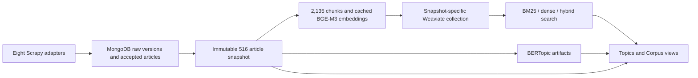

# Architecture and current status

## Verified data path

The 13 November 2026 local rehearsal passed for this configured environment.
It exercised Search, Topics and Corpus against the active snapshot, and a
scratch restore reused all 2,135 cached chunk vectors in 6.012 seconds without
activating them or re-embedding. This is not a fresh-clone or full-pipeline
reproduction. See [the verification report](VERIFICATION_REPORT.md) and
[setup/runbook](setup.md).

## Components and evidence

- **Collection:** Eight bounded live Scrapy adapters: `abp_en`, `oneindia_en`,
  `abp_hi`, `amarujala_hi`, `abp_bn`, `news18_bn`, `abp_mr`, `loksatta_mr`.
  The campaign accepted 516 articles (English 123, Hindi 116, Bengali 156,
  Marathi 121), with 586 raw versions and 66 rejected versions. These are
  section-derived weak labels and uneven coverage: environment count is zero;
  near-duplicate and syndication checks remain incomplete.
- **Snapshot and index:** `corpus-59b2b589fe3bbdbffdc3` freezes 516 articles
  and 2,135 chunks. Its manifest SHA-256 is
  `0c56de1aafcbd32d19e68f8c0b99f2f31f1f5c5e89a49cbeae20acf416bb5eb2`; the
  chunk data SHA-256 is
  `db3f0a1727b264f5c73df330e407ea3468f34c812d3b36d94b76e3fd7b303c16`.
  The dedicated Weaviate collection passed ID, provenance and vector readback.
- **Retrieval:** BM25, BGE-M3 dense, and hybrid are implemented and shown in
  the UI. The saved held-out evaluation has 48 queries and 427 pooled unique
  query/article pairs. Its score is `incomplete` with `metrics: null` because
  human judgments are absent. UI reranking was observed; reranking was omitted
  from the saved evaluation pool.
- **Topics:** BERTopic produced 11 non-noise topics and 17 outliers from the
  same snapshot. Comparison to TF-IDF/KMeans uses coarse publisher-section
  labels; those scores do not establish factual truth or event coherence.
- **API/UI:** FastAPI exposes Search, Topics and Corpus data, plus chat and an
  optional summary endpoint. Summary provider access is unverified. The local
  rehearsal displayed the unavailable summary state. Playwright's 503 state
  was explicitly simulated by request interception; it was not a live outage.

## Deferred and incomplete

Slice 09's engineering/provenance checks passed, but relevance-quality
acceptance remains unmet: at least 86 pairs must be double-judged, with at
least 513 initial helper decisions overall, followed by agreement,
adjudication and score review. No synthetic or generated labels are valid
substitutes. Airflow, continuous ingestion, summary-provider verification,
near-duplicate/syndication checks, and a fresh-clone full-pipeline rehearsal
are deferred or unverified. Overall project completion is not claimed.
