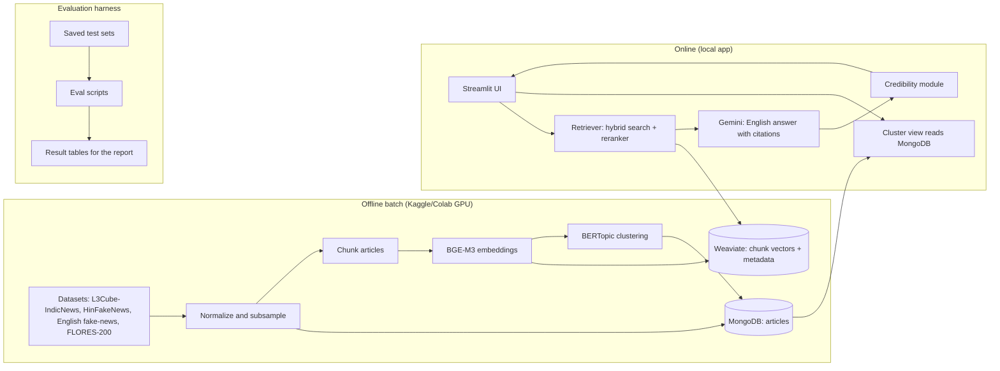

# ARCHITECTURE: Multilingual News Intelligence Platform


 2. System overview



## 3. Components

| Component | Choice | Role |
|---|---|---|
| Document store | MongoDB | Full articles, metadata, cluster assignments, test sets, cached answers |
| Vector store | Weaviate (bring-your-own vectors) | Chunk vectors, BM25 + vector hybrid search, metadata filters |
| Embeddings | BGE-M3 (fp16) | Shared multilingual space for EN/HI/BN/TA; 1024-dim dense vectors |
| Lexical baseline | BM25 (Weaviate or `rank_bm25`) | Baseline for retrieval |
| Comparison embedder | multilingual-e5-base | Second embedding model for the retrieval comparison |
| Reranker | bge-reranker-v2-m3 (cross-encoder, fp16) | Rescores the top 30 hybrid results; the top 5 to 8 go to generation |
| Generator and judge | Gemini Flash API | English answers with citations, veracity labels, LLM-as-judge |
| Clustering | BERTopic on BGE-M3 vectors (UMAP + HDBSCAN) | Topic/event view |
| UI | Streamlit | Chat, Search, Clusters screens in one Python app |
| Orchestration | Plain Python package (`core/`) | No separate API server; the UI calls the modules directly |

**Why Streamlit and no API server:** the project is graded on NLP, and a single Python app removes a whole layer to build and debug. If time allows, `core/` can be wrapped in FastAPI later without changes.

## 4. Data flow

### 4.1 Offline pipeline (run once or twice)
1. **Ingest:** read the datasets, drop empty articles, remove exact duplicates (hash of normalized text), and subsample about 5,000 articles per language from L3Cube-IndicNews. After embedding, remove near-duplicates within each language (cosine similarity above a threshold of about 0.95, tuned on a sample you inspect by hand).
2. **Store:** write articles to MongoDB (`articles` collection).
3. **Chunk:** split each article body into passages of roughly 200 to 300 tokens with a small overlap. The title is prepended to each chunk.
4. **Embed:** run BGE-M3 on a Kaggle T4 in fp16. Export vectors to disk.
5. **Index:** load vectors and metadata into Weaviate.
6. **Cluster:** run BERTopic on article-level vectors, label clusters, and write assignments to MongoDB.
7. **Test sets:** store the hand-written queries, Q&A pairs and misinformation test splits in MongoDB or JSON files.

### 4.2 Online query flow (RAG)
1. The user query is embedded locally with BGE-M3 (fp16, fits in 4 GB).
2. Weaviate runs hybrid search (vector plus BM25) and returns the top-k chunks, optionally filtered by language or category.
3. Rerank the top 30 chunks with bge-reranker-v2-m3 and keep the top 5 to 8. Drop chunks from articles already represented, and drop near-identical chunks (similarity above the dedup threshold), so each citation is a distinct source.
4. The top chunks go into a prompt for Gemini, which must answer **in English**, use only the provided passages, cite chunk ids, and say "not found" when the evidence is missing.
5. The credibility module labels each cited article and computes the cross-source agreement.
6. The UI renders the answer, citations (title, language, source, link) and flags.

### 4.3 Credibility module
- **Per article:** Gemini classifies the article as Likely reliable, Uncertain or Likely misleading and gives a one-sentence reason. The evaluated variants are zero-shot and zero-shot with retrieved evidence.
- **Per answer:** the agreement indicator is the share of the top-k sources, across languages, whose content supports the main claim (decided by an LLM entailment prompt).
- **Evaluation:** macro-F1 on HinFakeNews and the English dataset against a TF-IDF + logistic regression baseline. The classical baseline is trained from scratch in a few lines and is not a fine-tuned pretrained model.

## 5. Data model

### MongoDB

`articles`
```json
{
  "_id": "hi_000123",
  "lang": "hi",
  "title": "...",
  "body": "...",
  "category": "sports",
  "source": "l3cube-indicnews",
  "url": null,
  "date": null,
  "cluster_id": 17,
  "n_chunks": 4
}
```

`clusters`
```json
{ "_id": 17, "label": "...", "size": 312, "lang_counts": {"en": 80, "hi": 91, "bn": 70, "ta": 71}, "top_terms": ["..."] }
```

`eval_queries`, `eval_qa`, `eval_misinfo` hold test sets. `answers_cache` holds cached demo answers.

### Weaviate class `NewsChunk`
- Vector: BGE-M3 dense (1024-dim), supplied by the pipeline (no built-in vectorizer).
- Properties: `article_id`, `chunk_index`, `text`, `title`, `lang`, `category`, `source`.
- Hybrid search combines the vector score and BM25 on `text`.

## 6. Models and compute

| Task | Model | Where it runs |
|---|---|---|
| Corpus embeddings | BGE-M3 fp16 | Kaggle/Colab T4 (batch, once) |
| Query embeddings | BGE-M3 fp16 | Local RTX 3050 Ti (4 GB) |
| Comparison embeddings (FLORES test only) | multilingual-e5-base | Kaggle/Colab or local |
| Reranking (30 candidates per query) | bge-reranker-v2-m3 fp16 | Local RTX 3050 Ti (load after the query embedding, or run both in sequence to stay within 4 GB) |
| Generation, judging, veracity labels | Gemini Flash | API |
| Clustering | BERTopic | Local CPU after embeddings exist |

## 7. Evaluation harness

- Each experiment is a script that reads a config, a test set and a model name, and writes a JSON/CSV result file.
- A single `make eval` (or `python -m eval.run_all`) regenerates all tables for the report.
- Random seeds are fixed. Model versions and prompt text are saved with the results.
- LLM-judge outputs are saved, and a manual sample is checked and the agreement reported.

## 8. Repository layout

```
news-intel/
  README.md
  PRD.md
  PRODUCT.md
  ARCHITECTURE.md
  docker-compose.yml        # MongoDB + Weaviate
  config/
    default.yaml
  data/                     # raw and processed data (git-ignored)
  notebooks/
    01_embed_corpus_kaggle.ipynb
  core/
    ingest.py               # datasets to MongoDB
    chunking.py
    embed.py                # BGE-M3 wrapper
    index.py                # Weaviate schema and load
    retrieve.py             # dense, BM25, hybrid
    rerank.py               # bge-reranker-v2-m3 cross-encoder
    dedupe.py               # exact + near-duplicate removal, citation dedupe
    rag.py                  # prompt, generation, citations
    credibility.py          # veracity labels and agreement
    cluster.py              # BERTopic
  eval/
    retrieval_flores.py
    retrieval_news.py
    rag_eval.py
    cluster_eval.py
    misinfo_eval.py
    run_all.py
  app/
    streamlit_app.py        # Chat, Search, Clusters pages
  tests/
```

## 9. Deployment

- `docker-compose up` starts MongoDB and Weaviate locally.
- `streamlit run app/streamlit_app.py` starts the UI.
- Secrets (the Gemini API key) are in environment variables, never committed.
- For the demo, the example queries are pre-run and cached so the demo works even if the API is slow.

## 10. Key trade-offs

| Decision | Reason | Cost |
|---|---|---|
| One shared embedding model for all languages | Simplest path to cross-lingual retrieval and easy to explain | Quality varies by language; measure it per language |
| Gemini does multilingual reading and English answering | Removes the need for a separate translation model | Depends on an external API |
| No fine-tuning | Fits the timeline; keeps the contribution on evaluation | Lower ceiling on misinformation accuracy |
| Streamlit, no API server | Less engineering, faster demo | Less production-like |
| L3Cube articles are not parallel | Clean labeled data in all four languages | No same-event ground truth; use FLORES and hand-written queries instead |

## 11. Risks (technical)

- **Chunk quality for Indic scripts:** token counts differ by language, so chunk by tokenizer length, not characters.
- **Weaviate memory use:** keep the index to about 20,000 articles (a few tens of thousands of chunks), which is comfortable on a laptop.
- **Prompt injection from article text:** the generation prompt treats retrieved text as data, not instructions.
- **Evaluation leakage:** keep the hand-written test queries out of any prompt tuning.
