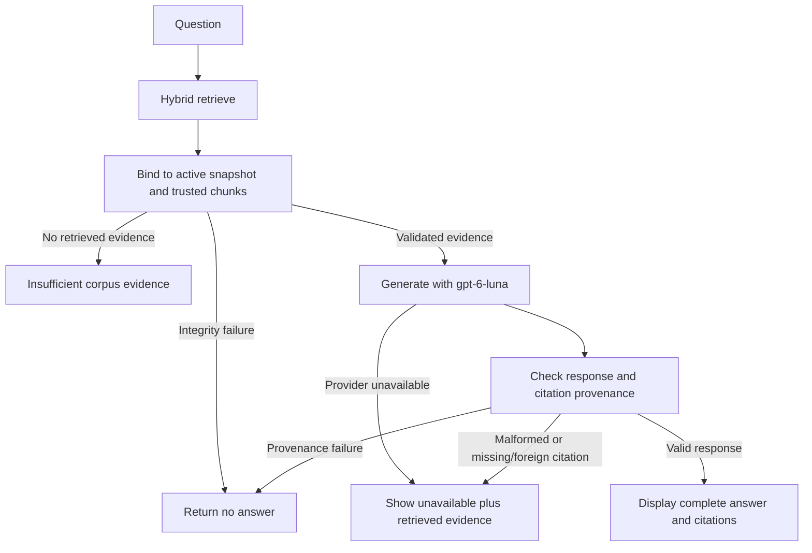

# Grounded News Q&A: design and implementation plan

**Status: approved design; bounded application review reached its eight-call cap; final user acceptance pending.** Focused API and frontend local gates passed. After the first request returned `503` because CUDA retrieval embedding ran out of memory before generation, independent hybrid Search passed with CPU embeddings (10 results from the expected active snapshot; query embedding 2.701 and 4.444 seconds). Five complete answers, one unsupported-question abstention, and one supported partial answer with a gap passed independent passage/citation review. Coverage includes EN/HI/BN/MR and one EN answer grounded in Bengali evidence. No genuine conflicting-source example was identified. The unsupported question contained an instruction to ignore evidence, but its returned citations were unrelated; this does not establish citation relevance or general/article-passage injection resistance. The first and eighth attempts have no observed provider usage; their `$0.003` reservations remain counted. Known actual usage cost through attempt 7 is `$0.0015756`; all eight attempts reserved `$0.024`. See [the verification report](VERIFICATION_REPORT.md) for limits and unresolved coverage.

## Outcome and scope

Add a dedicated **Ask** page to the existing Search / Topics / Corpus research workspace. A reader asks one question about the frozen news corpus and receives a direct answer with claim-linked citations. The answer uses the question's language and may draw on any corpus language. The first demo supports English, Hindi, Bengali, and Marathi questions and answers; other languages are outside its tested scope. Cross-language interpretation must be assessed, and the demo must not claim retrieval or answer quality that has not been established.

The initial corpus is snapshot `corpus-59b2b589fe3bbdbffdc3` (516 articles, 2,135 chunks). Reuse the existing BM25/dense/hybrid retrieval and Weaviate index. Use one fixed hybrid retrieval over all corpus languages with the original question and BGE-M3, with reranking disabled. Do not add translation calls, translated query variants, or another index. Each question stands alone; there is no chat history or follow-up query rewriting.

The feature is bounded evidence Q&A, not general chat. The app must not supplement missing corpus evidence with model knowledge. When evidence only supports part of a question, return the supported portion, cite it, and say what remains unanswered. When the frozen corpus has no supporting evidence, decline the factual answer and say the corpus is insufficient. If retrieved evidence fails snapshot/provenance integrity checks, return no answer. If OpenAI fails after valid retrieval, show generation as unavailable and keep the retrieved evidence visible; never fabricate an answer or switch provider/model.

## Settled decisions

| Area | Decision |
| --- | --- |
| User need | Answer questions across retrieved news articles with a direct synthesis and citations; demonstrate multilingual synthesis on suitable questions. |
| Page | Dedicated Ask page beside Search, Topics, and Corpus. |
| Languages | English, Hindi, Bengali, and Marathi are the supported/tested first-demo languages. Answers match the question language. Mixed-language handling is unspecified and outside tested scope; no separate language detector or rejection logic is agreed. |
| Evidence | Use relevant evidence even when all supporting articles are in English. There is no minimum number of source languages. Assess cross-language interpretation and translation fidelity. |
| Retrieval | One existing fixed hybrid retrieval across corpus languages using the original question and BGE-M3; no reranking, translation call, or multilingual query fanout. Assess cross-language misses, and make no retrieval-quality claim. |
| Answer behavior | Claim-linked citations; partial supported answers identify gaps. Conflicting accounts are attributed and described without declaring a winner absent evidence. No-evidence questions are declined without model general knowledge. |
| Trust checks | Automatically verify citation IDs and snapshot/chunk/article provenance before displaying an answer. This does not prove factual claim support. Agents review outputs against passages during implementation; the user performs final acceptance. There is no runtime semantic guarantee. |
| Workflow | A small fixed PocketFlow workflow with retrieval, evidence checks, generation, and response checks as stages. Reuse retrieval/indexing; no dynamic agent or history. |
| Provider | `gpt-6-luna` through the direct OpenAI API. Verify access only through an actual application generation test. If unavailable, report it; do not use another model/provider. |
| First-demo delivery | Polished loading and citation experience; show a complete checked answer, never stream tokens. On generation failure after valid retrieval, show unavailable status plus evidence. |
| Test ownership and spend | The main agent coordinates; subagents execute all tests and review outputs/findings. Project API calls are allowed only inside actual end-to-end app generation tests, never standalone probes or judge calls. The total implementation-test cap is US$0.50 including retries. Stop and report gaps rather than request more budget. |
| Readiness | Require passing local checks and subagent-reviewed end-to-end app tests across the four supported languages, cross-language evidence, and edge cases. Measure latency, record limitations, fix within the US$0.50 cap, and report anything unresolved without extra spend. |

## Approved implementation defaults

These defaults make the implementation executable and are approved as the implementation baseline. Follow an official API constraint if it makes a numeric limit unsupported, document the smallest necessary equivalent, and do not add a later user-decision gate.

| Detail | Default |
| --- | --- |
| Endpoint and request | `POST /api/ask` with `{ "question": "..." }`; reject empty or over 2,000 Unicode-code-point questions using normal request validation. |
| PocketFlow stages | `Retrieve` → `BindEvidence` → `Generate` → `ValidateResponse`; fixed linear flow with explicit terminal outcomes for no evidence, integrity failure, and provider failure. |
| Retrieval | Existing hybrid retrieval with `hybrid_alpha=0.7`, no language filter, no reranking. Take up to 30 runtime candidates, then at most 8 trusted chunks for bounded generation context. This reuses the method/alpha, not the saved evaluation rankings (which used 150 candidates and article-level top five); no quality claim follows. |
| Evidence bound | At most 8 validated chunks and a full prompt limit of 12,000 UTF-8 bytes, including system/schema and question overhead. Trim only by dropping complete chunks from the end of retrieval order; never truncate or paraphrase quoted evidence. If no complete chunk fits, return `generation_unavailable` with reason `context_limit` and validated evidence. If accounting cannot conservatively bound a request, do not make a live call. |
| Generation bound | Set `max_output_tokens=1024` and one 45-second overall generation timeout. Disable SDK retries. If official model/API constraints require a supported equivalent, keep the bound no larger and record it in the handoff. |
| Answer contract | Explicit status plus answer segments; every segment must carry one or more citation IDs. A separate gap field names unanswered parts. The server resolves citation IDs to trusted passages and metadata. |
| Invalid model response | Missing/foreign citations, malformed or truncated output, or unsupported status yields `generation_unavailable` with reason `invalid_model_response`, validated evidence, and no partial answer. Provenance failure yields `evidence_integrity_error`, no answer, and an empty citations array. |
| Citation links | Accept only `http` or `https` article URLs; render passage and title as escaped text. Invalid URLs fail response validation and are not linked. |
| Injection check | A local stub test verifies article/question text is treated as data and rendered safely. This does not prove model resistance. Runtime injection resistance remains unverified unless an actual app attack case is reviewed within the call budget. Never mutate the frozen corpus for this check. |
| Live-call plan | One serialized worker; at most 8 paid end-to-end app generation attempts total, including retries. First four cover one question in each supported language, including a suitable cross-language-evidence case; up to four further attempts are reserved for bounded fixes/rechecks and one adversarial case if useful. Do not spend reserved calls if earlier results suffice. Two bounded improvement rounds maximum. |
| Spend accounting | Reserve worst-case input/output cost before every call; do not refund failed or ambiguous attempts unless authoritative usage confirms cost. Include hidden retries or disable them. Stop before US$0.50; this controls project calls, not unrelated account spend. |

## Approved workflow and API

The graph below is the fixed path, using the defaults above.

**Retrieval and trusted evidence.** Pass the original question to existing hybrid retrieval with `hybrid_alpha=0.7`, no language filter and no reranking. Take up to 30 runtime candidates, then at most 8 trusted chunks. This reuses the hybrid method and alpha, not the saved evaluation rankings: those used 150 candidates and article-level top five. It establishes no retrieval quality. Resolve the active snapshot using `api.snapshot_evidence.load_active_snapshot()`, then use `core.snapshot_index.load_snapshot()` for the authoritative `chunks.jsonl` mapping. The first helper validates the active snapshot/article manifest; the latter validates the chunk checksum/count, snapshot identity, required provenance, and deterministic chunk IDs. Join retrieved IDs to that authoritative map before generation and before constructing returned citations. Give generation only an allowlist of citation IDs mapped to validated passages; never trust model-supplied chunk IDs, passage text, article metadata, or URLs. If the active snapshot changes during a request, a retrieved chunk is absent, or a mapping/provenance check fails, stop and return no answer. Reuse these helpers; do not add another vector store or a second snapshot implementation.

The existing helpers validate identity and provenance, not whether a passage semantically supports a claim. An empty retrieval can be declined deterministically. For nonempty retrieval, the generation instructions must restrict claims to the supplied passages and request explicit gaps/abstention, but the app cannot guarantee semantic support at runtime. Reviewer subagents inspect actual answers against their saved passages; this is an engineering review, not a gold-label set or a proof of general quality.

**Generation and response checks.** Send only the question and a bounded set of validated passages to `gpt-6-luna` through the direct OpenAI client already in the project. Keep credentials in the user's existing application runtime configuration; agents must not inspect `.env` files or key values, and must not request or reproduce a key. Do not give the model tools, browsing, or database access. Treat both the question and article text as untrusted input: clearly mark retrieved text as evidence rather than instructions, ignore instructions embedded in it, and test a prompt-injection example.

Have generation return answer segments with citation IDs, not passage text. Every segment requires citations; the model cannot bypass checks by labeling a statement non-factual. A response-check stage validates the shape and rejects any citation not present in the validated retrieved set. Missing/foreign citations and malformed/truncated output return `generation_unavailable` with reason `invalid_model_response`, the validated retrieved evidence in the citations array, and no partial answer. If the full bounded prompt cannot fit one complete evidence chunk, return `generation_unavailable` with reason `context_limit` and validated evidence. Snapshot/chunk/article provenance failure returns `evidence_integrity_error`, no answer, and an empty citations array. The citations array is built by the server from the authoritative map, including the exact original passage and article URL/title/source/language/date; it holds bounded validated retrieved evidence even when no answer is available. Only `http` and `https` article URLs become links. The client displays citations beside answer segments, and presents the same evidence array as a source list in unavailable states. Render passage text as escaped text; do not inject scraped HTML. These checks improve inspectability but do not prove semantic claim support.

Use `POST /api/ask` with `{ "question": "..." }`; responses include `status`, `answer_segments`, `gap`, `citations`, `snapshot_id`, and an optional machine-readable `reason`. `citations` is the server-built map of validated retrieved passages and article metadata, also used as the source list when generation fails; it is empty on evidence-integrity failure. Statuses are `answered`, `insufficient_evidence`, `generation_unavailable`, and `evidence_integrity_error`. Integrity errors carry no answer or evidence. Reject empty or over-2,000-code-point questions using normal request validation. Do not preserve a compatibility layer for legacy chat or Search-summary generation. Update known callers, while preserving useful retrieval/indexing paths.

## Cost and provider-access gate

The US$0.50 cap covers all project API usage during implementation testing, including actual generation tests and retries. It is a cap on the calls agents make for this project; it cannot guarantee or control unrelated account-wide spend. Before the first live app test:

1. Recheck official `gpt-6-luna` pricing and token-limit documentation at execution time; pricing can change. The current official references are [model pricing](https://developers.openai.com/api/docs/models/gpt-6-luna) and [reasoning cost controls](https://developers.openai.com/api/docs/guides/reasoning). The documented output-token limit includes reasoning tokens, so a response may consume that limit before visible answer text is complete.
2. Set a conservative input estimate using the full prompt and uncached-input price, the 12,000-byte input bound, and the 1,024-token output cap. Include every potential call and retry in the estimate. If the worst-case request cannot be bounded, do not make it.
3. Keep a tiny serialized manual test ledger: request purpose, estimated input/output cost, reserved amount, provider-reported usage/cost when available, and cumulative total. Reserve the maximum estimated cost before each serialized call, then reconcile actual usage. Do not refund failed or ambiguous calls absent authoritative usage. Disable hidden SDK retries or account for each retry as a separate reserved call. Use one serialized worker and at most 8 paid app attempts, including retries; do not spend reserved calls if prior results suffice. Limit improvement to two bounded rounds. Do not add a billing framework or dependency.
4. Stop before cumulative reserved/actual test spend could exceed US$0.50. If the key is unavailable through existing app configuration, access fails, usage cannot be bounded, or the cap is reached, report generation/access as unverified or unavailable and list the remaining test gaps. Do not make a direct provider probe, substitute a fake provider as proof of live wiring, or request extra budget mid-execution.

Use pricing estimates to control the test calls, not to claim a provider-side hard billing guarantee. Report the actual observed API usage and measured end-to-end latency for completed app tests. Set no arbitrary latency target in advance.

## Ask page behavior

Use the existing Next.js, React, Lucide, and CSS patterns; no new animation or UI dependency. Show a clear loading state while retrieval and generation run. Reveal the answer only after the provenance checks complete. Keep citations beside claims, show the exact corpus passage on inspection, and link to the original article. On provider failure after valid retrieval, show an honest unavailable state alongside the evidence. On no evidence, show the corpus-insufficient response with no model-generated factual answer. On snapshot/citation integrity failure, show no answer. Do not stream partial model output.

Meet the requested polished loading/citation experience with existing components and CSS. Keyboard behavior, reduced-motion treatment, and truthful status presentation are design requirements to verify; `frontend/src/app/globals.css` already contains reduced-motion support. These are implementation recommendations for accessibility and clarity, not a selected UI library.

## Implementation and review slices

All work remains delegated. The main agent coordinates; bounded subagents own implementation, tests, documentation corrections, and independent review. Keep the diff small and use current project patterns.

### Slice A — Evidence-bound API workflow

Implement one fixed PocketFlow flow around the existing retrieval and snapshot helpers. Add the smallest focused deterministic checks for: empty retrieval (no provider call), exact active-snapshot/chunk/article binding, citation ID from another snapshot, missing chunk, malformed model response, missing/foreign citation, provider unavailable after retrieval, and no answer after integrity failure. Check the no-evidence/partial-answer and conflicting-source instructions. Use a provider stub for deterministic branches; it does not prove multilingual behavior or live OpenAI wiring. Add one prompt-injection fixture and verify locally that text is isolated as untrusted data and safely escaped. This checks prompt construction/rendering, not model resistance; runtime resistance remains unverified unless an actual app attack case is reviewed within budget. Do not mutate the frozen corpus.

Remove obsolete legacy chat and Search-summary generation routes/helpers/contracts/callers/tests/docs where they are generation-specific. Preserve shared hybrid retrieval, the validated indexing/snapshot artifacts, Search, Topics, Corpus, and unrelated summary/evaluation work only if it is not a legacy generation path. Do not add a compatibility layer. Use the endpoint and response contract in the approved defaults above.

### Slice B — Ask page

Add the dedicated Ask page beside the existing research pages. Connect it using the API contract above. Render validated citations from API data, provide loading/unavailable/insufficient-evidence/integrity-error states, and keep scraped content escaped. Render invalid model output as generation unavailable with source evidence; render provenance/integrity failure with no answer and no evidence. Reuse existing styles and controls; no new UI package. Check keyboard navigation, reduced motion, mobile layout, citation links, and honest errors with the project's existing frontend gates.

### Slice C — Bounded end-to-end review and handoff

Subagents run all tests and independently review the connected API/UI path. First run local tests with stubs and no provider spend. Then, only if app configuration/access exists and the serialized cost ledger passes preflight, make a few actual application calls covering English, Hindi, Bengali, and Marathi questions plus at least one suitable cross-language-evidence case. The calls must exercise the normal app generation workflow. The reviewer inspects each saved question, retrieved passage, generated answer, citations, and observed usage; do not create human gold labels or claim aggregate quality from this small sample.

Use the local frozen corpus for no-evidence, partial-evidence, conflicting-report, prompt-injection, and cross-language-miss cases; keep paid calls to the minimum needed for coverage. Exercise provider failure, snapshot mismatch, invalid citation, and stale evidence with deterministic local tests. One serialized worker may make at most 8 actual app generation attempts total, including retries. The first four cover each supported language and include a suitable cross-language evidence case; reserve up to four more for at most two bounded improvement rounds and one adversarial case if useful. Do not spend calls merely to consume the allowance. Record successful and failed examples, languages and evidence types tested, measured latency, API usage, cost, and gaps. If the cost cap or provider access prevents a case, report it unverified; do not claim readiness. The user gives final acceptance after subagent review.

### Completion checklist

- [x] Current-snapshot retrieval is bound to checksum-validated chunk/article provenance before generation and before answer display.
- [x] No model-generated passage or citation can bypass server-side mapping to the authoritative chunk set.
- [x] No answer is returned on evidence-integrity failure; OpenAI failure never creates a fabricated answer or provider fallback.
- [ ] Genuine conflicting-source handling remains unverified because no suitable conflict example was identified. The single unsupported-question instruction test does not establish article-passage injection resistance.
- [x] Supported-language responses, one cross-language evidence example, one unsupported-question abstention, no-evidence/provider/integrity local branches, citation IDs, and provenance behavior were exercised within the cap.
- [x] Existing retrieval/indexing remains in use; legacy generation paths and their callers/docs are removed or updated, with no compatibility layer.
- [x] Ask page passed local accessibility and truthful-state checks without a new UI dependency.
- [x] Independent reviewers reviewed the captured cases and local gates.
- [ ] User acceptance of the bounded demo and remaining limitations.
- [x] The report states what was tested and does not claim semantic runtime guarantees or retrieval/answer quality from proxies or a few examples.

## Implementation details within the approved defaults

The implementation may choose internal shared-store key spelling, normal validation/error-envelope conventions, the deterministic truncation routine, and exact loading/offline copy to match existing project patterns. Keep the approved endpoint, node stages, evidence/input/output/time bounds, citation requirements, failure behavior, and cost limits. Do not introduce another design approval gate for these details.
