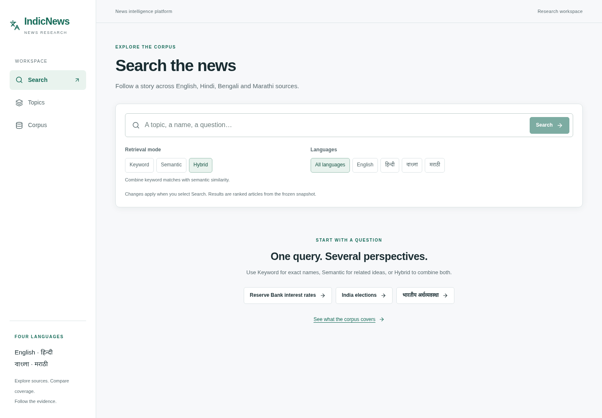
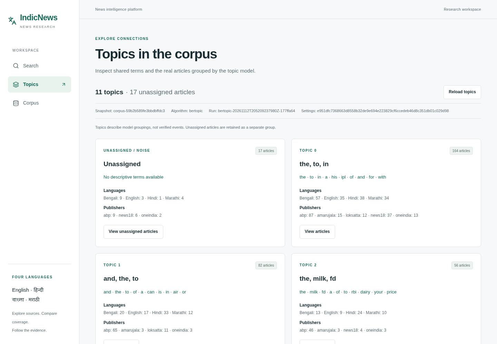
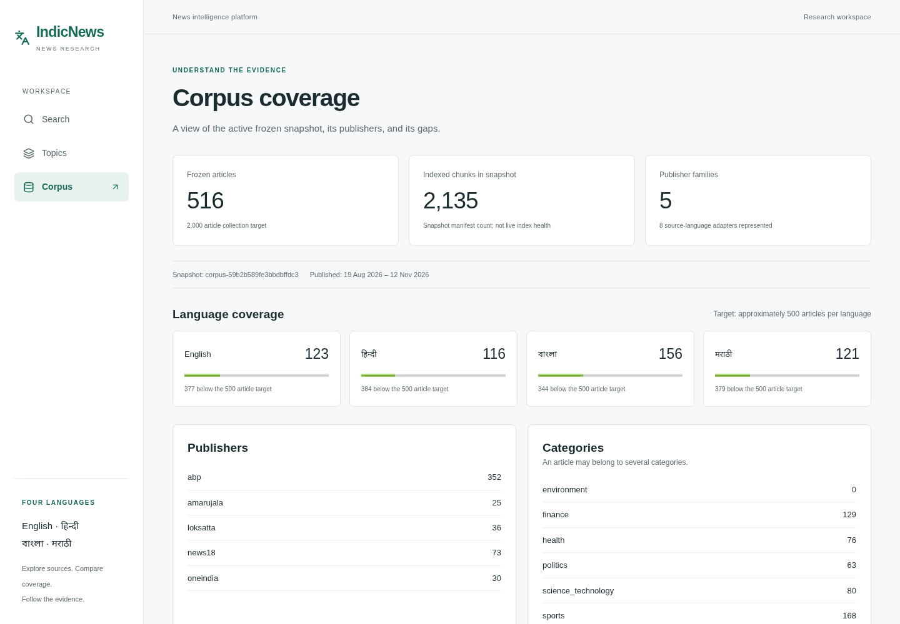
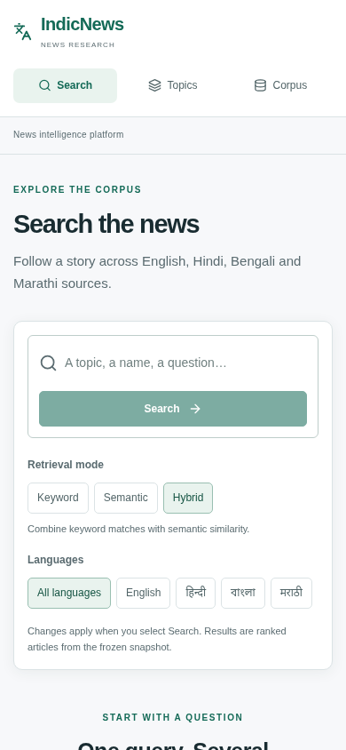

# Frontend guide

The Next.js workspace presents Search, Ask, Topics, and Corpus over the active
frozen snapshot. It is a browser for collected reporting and model groupings,
not a fact checker or a measurement of retrieval quality.

## Run locally

Start MongoDB and Weaviate, then start the API and frontend using the steps in
[setup.md](setup.md). Set `NEXT_PUBLIC_API_URL` in `frontend/.env.local` to the
API origin (normally `http://localhost:8000`). Open `http://localhost:3000`.

## Routes

- **Search** accepts a query, one retrieval mode, and an optional language
  filter. Keyword uses BM25, Semantic uses dense retrieval, and Hybrid combines
  them. Results include source, date when available, a snippet and the original
  publisher link. The execution row reports requested/executed mode, reranker
  status, elapsed time, and snapshot. Ask is a separate, one-question flow;
  see below.
- **Ask** sends a standalone question to `POST /api/ask`. The first-demo
  language scope is English, Hindi, Bengali, and Marathi, although end-to-end
  runtime coverage is still being reviewed. Generation is instructed to use
  passages from the frozen corpus; each displayed citation links to its validated
  passage and article. The UI distinguishes insufficient evidence, generation
  unavailable, and evidence-integrity failure. Provenance checks do not prove
  that a passage semantically supports every claim, and the page makes no
  retrieval or answer-quality guarantee.
- **Topics** lists the saved BERTopic groups and an explicit unassigned/noise
  group. Topic details show real snapshot articles with source links and
  pagination. These are model groupings, not verified events or true topic
  labels.
- **Corpus** reports the active snapshot's article and chunk totals, language,
  publisher-family, and section-category coverage. It distinguishes snapshot
  counts from live index health. Crawl and rejection statistics are shown as
  unavailable when the snapshot does not contain those immutable references.

The interface distinguishes an empty successful response from an unavailable
service or stale snapshot. Empty/error Search and stale-topic browser checks
used intercepted synthetic responses, visibly marked as simulations; they are
not live corpus results. Keyboard navigation has a visible focus ring.

## Verified snapshot and limitations

The reviewed browser run used `corpus-59b2b589fe3bbdbffdc3`: 516 articles,
2,135 chunks, four languages, and five publisher families across eight
source-language adapters. The saved topic artifact contains 11 non-noise
topics and 17 outliers. Section categories are weak labels, coverage is
unbalanced, and no environment articles were observed. Search modes returned
20 results each in the smoke query, with reranking applied; this checks
execution and rendering only. Retrieval relevance and topic usefulness have
not been evaluated with human judgments. Publisher access notes are not legal
clearance, and raw article text remains local.

Airflow scheduling is deferred. The former Search-summary and chat generation
paths have been removed; historical verification records for them are labeled
as such.

## Browser evidence

These are clean idle-state screenshots from the final local browser build.
Search result behavior was checked separately against the live API. The mobile
Search capture is 390px wide. Ask's local browser checks covered 390px and
1440px widths, keyboard citation navigation, reduced-motion handling, escaped
passage text, and failure states. Its application-level language examples
remain pending; see the [verification report](VERIFICATION_REPORT.md).

The final browser checks found no horizontal overflow on Search, Topics, or
Corpus at 1440px and 390px. A later local rehearsal exercised a cross-language
search, source link, Topics, Corpus, the historical summary-unavailable state
and recovery; its Playwright 503 state was simulated by request interception. See
[VERIFICATION_REPORT.md](VERIFICATION_REPORT.md) and the
[runtime rehearsal record](../artifacts/demo_rehearsal/runtime_rehearsal.json)
for the separate evidence and boundaries.
